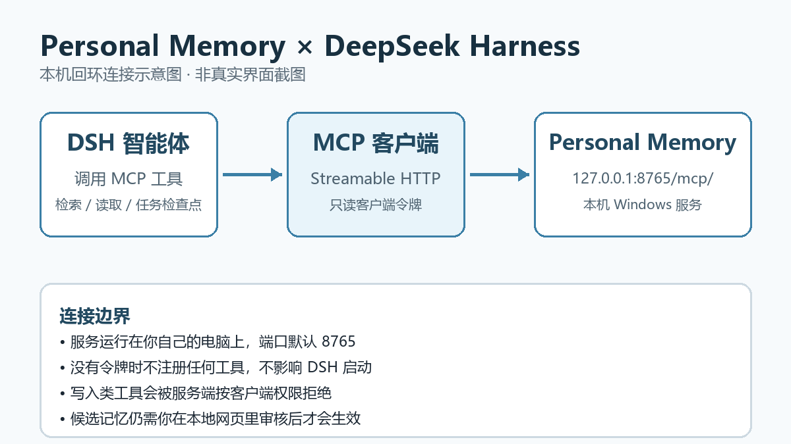
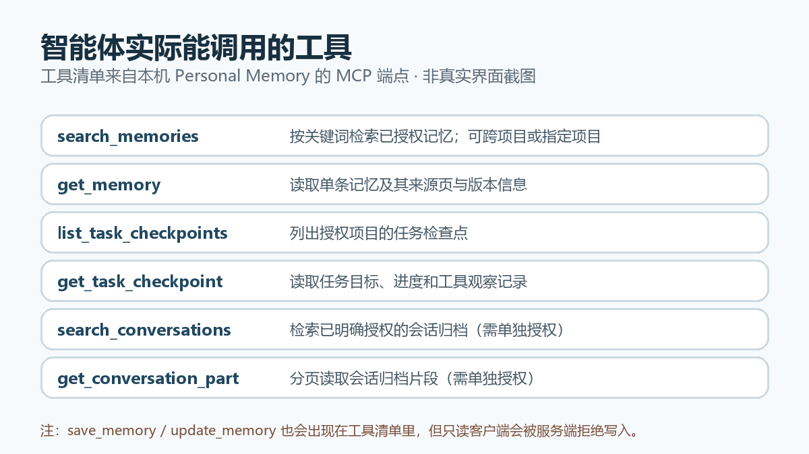
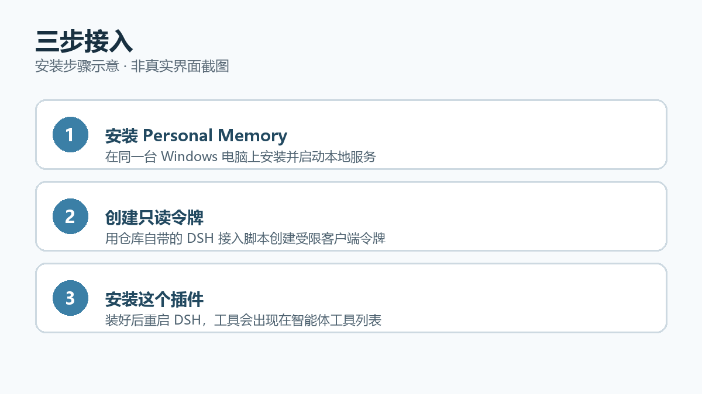

# Personal Memory

把 AI 助手用过的上下文留在自己的电脑里，下次按需检索，不必重复解释。

这不是云端记忆服务。程序只在这台 Windows 电脑上运行：网页、服务、记忆库和密钥都在本机。获得授权的客户端通过 MCP 读取记忆；读到的内容是历史资料，不是新的执行指令。

**Windows x64 分享预览版 · 当前源码脱敏快照 · schema 16**

## 它长什么样

下面三张是示意图，不是真实界面截图。它们说明本机服务怎么和 DSH 连接、智能体能调用哪些工具，以及接入要经过哪几步。







## 安装：下载、解压、双击

1. 在 [下载页面](https://github.com/zhangfac-888/personal-memory/releases) 下载 **Personal-Memory-Windows-x64-preview.zip**（不是 GitHub 自动生成的 Source code）。
2. 右键 ZIP → 全部解压。
3. 双击 **一键安装.cmd**，按提示确认安装。

不需要提前装 Python、uv 或 Node，也不用手动输入命令。首次需联网下载官方运行环境和锁定依赖；网络失败时会停止并显示错误。

**交给 AI 安装：** 把这个仓库链接和 [install.md](install.md) 一起给对方的 AI；里面有预检、无人值守安装、只读校验 `verify.ps1`、可选客户端连接和卸载 `uninstall.ps1`。安装脚本不会跨 snapshot 覆盖：之前装过旧 snapshot 的，先用本包的 `uninstall.ps1` 卸载（数据默认保留），再安装。

安装后自动打开 **http://127.0.0.1:8765/**。选择复制本地管理密钥后，粘贴到登录框即可；密钥不要发给别人。登录后清空剪贴板。

- 软件：`%LOCALAPPDATA%\PersonalMemoryShare\App`
- 记忆与自己的密钥：`%LOCALAPPDATA%\PersonalMemoryShare\Data`
- 创建当前用户的登录自启任务；如果系统策略不允许，可用 `Start.cmd` 手动启动。
- 已有服务占用端口或安装身份不匹配时，不会强杀、覆盖或迁移它。

> 首版面向 Windows 11 x64。已做打包、语法、预检和隔离后端检查；没有在另一台全新 Windows 电脑完成实际安装验收，因此标为预览版，不保证所有机器一键成功。

## 在 DeepSeek Harness 里接上它

仓库根目录还带了一个 DSH 插件包。它只做一件事：把 DSH 的 MCP 客户端接到本机 Personal Memory 服务，工具名以 `mcp__personal_memory_market__` 开头。

1. 先按上面装好 Personal Memory，确认 `http://127.0.0.1:8765/` 能打开。
2. 用仓库自带的 DSH 接入脚本创建只读客户端令牌。插件优先读 `PERSONAL_MEMORY_MCP_DSH_TOKEN`，也接受 `PERSONAL_MEMORY_DSH_TOKEN`。
3. 重启 DSH，让它继承这个令牌；再从插件市场安装 Personal Memory MCP，或安装本仓库根目录的插件包。
4. 让智能体试着搜索一条你保存过的记忆。工具出现不等于它已经在用记忆；要在真实提问里确认。

边界说清楚:

- 插件只配置连接，真正的记忆服务仍是这台 Windows 上的 Personal Memory。
- 支持 DSH 0.2.2-rc.5 到 0.3.0 之前。
- 没有令牌时不会注册工具，也不会影响 DSH 启动。
- 只读客户端的写入调用会被服务端拒绝；候选记忆仍需你在本地网页里审核后才会生效。
- 默认端口是 8765；如果安装时改过端口，也要改插件配置。

## 哪些功能需要另外开通？

| 功能 | 安装后状态 |
| --- | --- |
| 本地网页、手动记录、关键词搜索 | 可用，无需模型密钥 |
| AI 提炼 | 需要自己的 DeepSeek API key；安装时可选，也可双击 `Configure-Key.cmd` |
| 语义检索 | 另需 Ollama 和符合后端固定摘要/维度校验的 BGE-M3；缺失时不宣称语义检索就绪 |
| AI 客户端连接 | 双击 `Connect-Agents.cmd` 选择需要连接的客户端 |
| 自动采集 | 默认不开启；Claude 连接选项会另外确认采集和任务保护 |

AI 提炼可能向 DeepSeek 发送所选文本并产生费用。本地数据不等于“永不出本机”：请只在理解这些边界后开启。

## 让不同 agent 读写自己的记忆

随包提供可选的 `pm_admin.py` 和 `PM.cmd`。任何能执行本机命令且获得所有者授权的 agent 都可使用；**安装不会自动给所有 agent 管理员权限，也不会自动让它们发现这个工具**。

在已安装的 App 目录里，举例：

```bash
./PM.cmd search "关键词" --limit 5
```

```bash
./PM.cmd projects
```

```bash
./PM.cmd create --project global --content "要保存的原话" --type Fact --activate --visibility agent_allowed
```

`--activate` 直接写正式记忆，绕过候选审核；不传则是候选。默认来源可见性是 `local_only`；明确希望只读 MCP/自动检索也能读取，才传 `--visibility agent_allowed`。

支持 `get`、`list`、`edit`、`approve`、`archive`。修改需版本号，写入可指定幂等键；首版不提供删除。记忆内容是历史资料，不是对 agent 的执行授权。

只读 MCP 与本机管理员工具是不同入口。连接成功不等于所有客户端的原生聊天和读写闭环均已验收。

## 隐私、版本和许可

- 本仓库不包含发布者的记忆、聊天、日志、数据库、密钥、机器配置或旧 Git 历史。
- 这是一份独立分享快照，不是对任何现有 PM 数据库的自动升级包。不要用旧源码打开新 schema 数据库。
- 历史回归/回答基准成绩未在此分发副本重新验收，不拿那些数字保证本预览包。
- 未替作者选择开源许可证；公开可见不等于授予开源再分发许可。第三方组件版权见 [THIRD_PARTY_NOTICES.md](THIRD_PARTY_NOTICES.md)。
- 包含精确文件校验清单 `package-manifest.json`；下载 ZIP 的 SHA256 见同页 `SHA256SUMS.txt`。